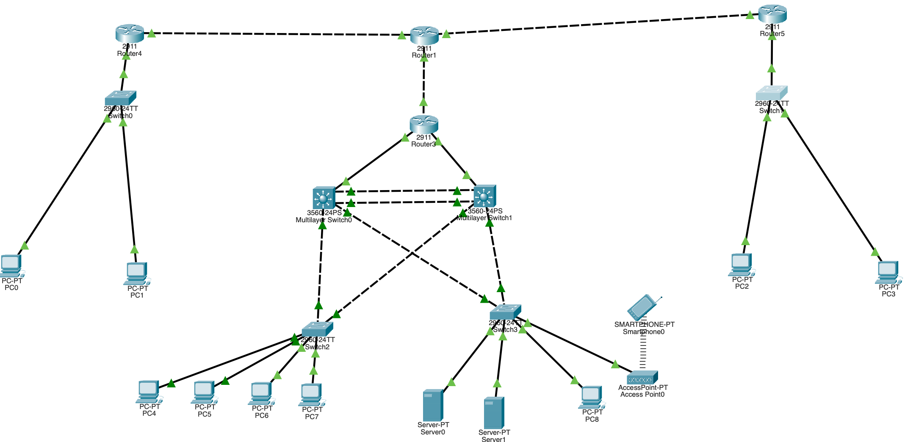

# CCNA Enterprise Network Project

## Project Overview
A multi-site enterprise network designed and implemented using Cisco Packet Tracer as part of my CCNA networking practice.

## Objectives
- Design a structured enterprise network for headquarters and branch offices.
- Configure VLANs and inter-VLAN routing.
- Implement routing, switching, and network security.
- Configure network services and test connectivity.

## Network Topology
The Packet Tracer project file is available in the [`topology`](topology/) folder.

## Devices Used
- Cisco 2911 routers
- Multilayer switches
- Access switches
- Servers
- PCs and a wireless access point

## VLAN and IP Addressing Plan
| VLAN ID | Name | Purpose |
|---|---|---|
| 10 | HR | HR department |
| 20 | Sales | Sales department |
| 30 | IT | IT department |
| 40 | Servers | Internal services |
| 50 | Guest | Guest wireless network |
| 99 | Management | Network device management |
| 999 | Native/Unused | Native VLAN and unused ports, as configured |

## Technologies
The project may include the following technologies, depending on the final configuration:
- VLANs and trunking
- Inter-VLAN routing
- Rapid PVST+
- EtherChannel using LACP
- DHCP
- OSPF
- NAT/PAT
- Access Control Lists (ACLs)
- SSH management
- DNS, HTTP, NTP, and Syslog

## Testing and Validation
Document successful tests here, including connectivity between VLANs, DHCP address assignment, DNS resolution, routing, and guest network isolation.

## Troubleshooting
Record issues encountered, the steps taken to diagnose them, and the fixes applied.

## Repository Structure
- `topology/` — Cisco Packet Tracer project file
- `configs/` — Router and switch configuration backups
- `diagrams/` — Network topology diagrams and screenshots

## Author
Aditya Anagunde
Add project README

